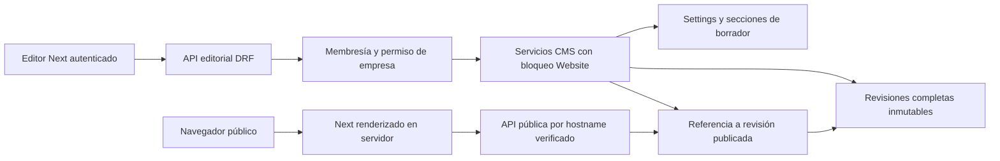

# 03 — Arquitectura propuesta del backend Website

Fecha: 15/11/2026. Propuesta para implementación posterior; ningún endpoint o modelo descrito aquí fue creado.

## Decisiones

1. Django sigue siendo autoridad de empresa, usuarios, permisos, inventario, precios y publicación. Next conserva componentes y diseño, adaptando acceso a datos.
2. Recuperar `apps/websites` de websites_v0 como dominio propietario de CMS, no crear otro CMS ni modelos paralelos de Product, Company o autenticación.
3. Primera versión: una web por empresa, conservando Website.company OneToOne. Un Website no es una sucursal. Multiwebsite por empresa requeriría cambio explícito posterior.
4. Usar un documento editorial v3 en la frontera API; persistir el borrador en entidades CMS recuperadas. Las revisiones inmutables guardan snapshots completos, no una segunda fuente mutable del borrador.
5. La publicación es del agregado editorial completo: identidad, contacto, SEO, banners, avisos, configuración y secciones. Un público nunca debe componer contenido desde settings mutables y una página publicada antigua.
6. Empezar la lectura pública con no-store. Caché e invalidación son una optimización posterior con pruebas por tenant; no son requisito de infraestructura nueva para el primer banner.

## Flujo

PostgreSQL mantiene draft, revisiones y referencia publicada. R2 mantiene archivos; guardar data URLs en PostgreSQL no constituye una integración de media aceptable.

## Límites del dominio y archivos previstos

| Capa | Responsabilidad / ubicación futura |
|---|---|
| Modelos | `apps/websites/models.py`: entidades recuperadas, constraints y pertenencia |
| Selectores | `apps/websites/selectors.py`: empresa autorizada, dominio y revisión publicada; consultas siempre acotadas |
| Servicios | `apps/websites/services.py`: guardar, publicar, restaurar, bootstrap y auditoría transaccionales |
| Validación | `apps/websites/blocks.py` + módulo nuevo de documento/adaptación: contrato v3, tipos y URLs; nunca ejecutar HTML/JS |
| Media | `apps/websites/media_storage.py`, reutilizando procesamiento de `inventory/product_image_storage.py` |
| HTTP | `apps/api/v1/websites/{urls,views,serializers}.py`: fachada editorial; API pública en namespace storefront |
| Permisos | Bases recuperadas/adaptadas en `apps/api/v1/permissions.py`; reglas específicas website sin bypass legado |
| Pruebas | `apps/websites/tests/`, regresión de `apps/inventory/tests/test_catalog_api.py` y pruebas E2E posteriores |

No usar serializers como única barrera: servicios verifican media/productos/listas/almacenes y reciben un contexto autorizado. Las vistas traducen HTTP y no concentran las reglas.

## Documento v3 y entidades existentes

| Campo de documento | Borrador canónico propuesto | Observación |
|---|---|---|
| identity/contact | WebsiteSettings, ampliado con campos faltantes | No escribir CompanyBranding; herencia inicial permitida sin sincronización destructiva |
| seo | Home WebsitePage + settings para defaults cuando corresponda | Una asignación de autoridad por campo; v3 title/description pertenecen al Home |
| banners/heroSlider | Un WebsiteSection de tipo nuevo `hero_slider.v1` | Conserva array, IDs editoriales, mobile image y parámetros; no aplastar en hero.v1 |
| announcements | Sección tipada `announcements.v1` | Máximo 8; CTA general y CTA por aviso permanecen diferenciados |
| specials | Sección `specials.v1` | Máximo 4 IDs reales; sin copias de precio |
| promotions | Sección `promotions.v1` | Fechas UTC, máximo 12; no reglas fiscales/descuentos |
| sections | Orden/visibilidad/título de secciones + metadata del bloque | Reconstrucción v3 sin perder categorías legacy ni secciones deshabilitadas |
| benefits/featured/about | Bloques tipados compatibles o ampliados | No prometer edición del cuerpo hardcodeado no expuesto por Next |

`hero_slider.v1` es un tipo de bloque propuesto, no una clase actualmente presente. `schemaVersion:3` del documento, versión del bloque y versión de plantilla son conceptos distintos. Mantener lectores históricos y convertir al DTO v3 mediante adaptador explícito con pruebas de ida/vuelta.

Media: resolver IDs de recursos del Website a URLs públicas permitidas. Mantener propiedades imageUrl/mobileImageUrl de la interfaz con adaptación; no aceptar una URL como prueba de pertenencia. Borradores locales previos solo se importarán con una acción explícita, saneamiento y validación; nunca automáticamente al iniciar sesión.

## Revisión y publicación

Propuesta mínima sobre los modelos recuperados:

- Añadir a Website un contador `editorial_revision` y referencia nullable `published_revision` a WebsitePageRevision del Home. Es una extensión, no un segundo modelo WebsitePublication.
- Reutilizar WebsitePageRevision, ampliando snapshot para incluir documento completo, template/schema y referencias de media. Mantener su secuencia version propia por página; no equipararla al ETag global.
- Cada save/publicación/restauración exitosa incrementa una vez editorial_revision. Guardados/restauraciones conservan una revisión auditable; publicación crea snapshot propio y actualiza referencia pública.
- Lectura editor devuelve `{revision,draft,published,...}`; `revision` controla todo el documento, no solo un bloque.
- Guardar/publicar/restaurar toman bloqueo sobre Website en el mismo orden, comprueban revisión, pertenencia y permiso, aplican cambios y escriben eventos en una transacción.
- Publicar valida de nuevo el borrador ya guardado y fija snapshot coherente; nunca publica el formulario no guardado.
- Restaurar copia snapshot al borrador, registra revisión/evento y no cambia published_revision. Luego se requiere publicación explícita.
- Recuperar una revisión no debe perder banners ocultos, ajustes del slider, identidad ni contacto. Guardar snapshot completo y proyectar una vista pública de campos habilitados.

No exponer las antiguas escrituras settings/pages/menus sin adaptarlas al bloqueo y contador: podrían cambiar el draft sin detectar ETag obsoleto. Eliminar/archivar una página publicada no debe invalidar su snapshot accidentalmente. Mantener integridad de la referencia publicada y prohibir hard delete referenciado.

Primera publicación: Website DRAFT con dominio ya verificado pasa a PUBLISHED dentro de la operación autorizada. La publicación no verifica ni activa dominios. Sin dominio activo no habrá contenido público accesible, aunque el contenido esté guardado/publicado.

## Resolución pública

Next obtiene el hostname de la petición procesada por su proxy autorizado, lo normaliza y consulta `/api/v1/storefront/sites/{hostname}/content/`. Django resuelve WebsiteDomain ACTIVE/verificado + Website PUBLISHED + Company activa + revisión publicada. Un parámetro company_id público no interviene.

El endpoint puede ser público y permitir consultar un hostname conocido: el contenido publicado ya es público. La selección por dominio no autentica a un editor. El servidor no sigue URLs del hostname, no hace fetch del sitio y no autoriza operaciones privadas por él. Ver política de proxy y amenazas en [06](06-seguridad-multiempresa.md).

Dominios personalizados requieren prueba de control previa. Los subdominios de plataforma también requieren asignación/activación autorizada; no asumir que cualquier subdominio pertenece al tenant de su etiqueta. Sin dominio válido: 404, sin fallback a primera empresa/demo.

## Integración Next posterior, sin rediseño

- Reemplazar fuente demo en `store.js` por funciones asíncronas servidor; usar variable de URL interna para SSR, sin secretos en NEXT_PUBLIC.
- Pasar `content` explícitamente a StoreHome. Si se omite, hoy genera defaults demo: el modo real debe fallar de forma visible en vez de inventar contenido.
- WebsiteEditor/WebsitePreview usan el repositorio API y capacidades servidor; conservar preview en memoria por postMessage para cambios aún no guardados, bajo la sesión editorial.
- Unificar getStore/header/footer/metadata/Home con la misma resolución y revisión para cada render; no mezclar respuesta de empresa A con layout B.
- Primera entrega informativa: contenido real, productIds vacíos y secciones comerciales deshabilitadas. No convertir productos demo en publicaciones reales. El panel editorial debe dejar inactiva la selección comercial pendiente; `/shop` y `/cart` continúan como demo identificada o quedan fuera del sitio piloto público hasta B4/B5.
- El botón de publicación cambia sus etiquetas a publicación real solo cuando funciona con API; separar modo informativo real de habilitación de cotización para que un WhatsApp configurado no active un carrito demo.

## Catálogo y ventas posteriores

WebsiteProduct enlaza Product; WebsiteCatalogSettings configura precio/almacenes sin duplicar maestros. Política estricta por empresa, publicación y moneda; disponibilidad derivada sin stock detallado. Precios en Decimal y DTO decimal string, sin aplicar IGV nuevamente a precios comerciales finales. Usar `resolve_commercial_price` y revisar coherencia con metadatos legacy de PriceList.

Para ventas, `SalesQuotation` es el modelo existente. Una solicitud anónima no aporta cliente fiscal, serie ni sucursal; el flujo inicial solo revalida y prepara mensaje WhatsApp. Una futura conversión autorizada deberá resolver esos datos, idempotencia y precios netos de líneas mediante servicios de sales. No crear otro modelo Quotation ni descontar stock por enviar WhatsApp.

## Decisiones pendientes antes de desarrollar

El diseño fija una web por empresa, contrato v3, ETag global y publicación por snapshot. Falta verificar esquema/BD real, dominios y media autorizados para pruebas, roles concretos y disponibilidad de PostgreSQL de integración. `corporate` se prepara como extensión del registro, sin implementación de plantilla nueva. Menús editables y destacados de categorías no se inventan como funcionalidades existentes del editor.
