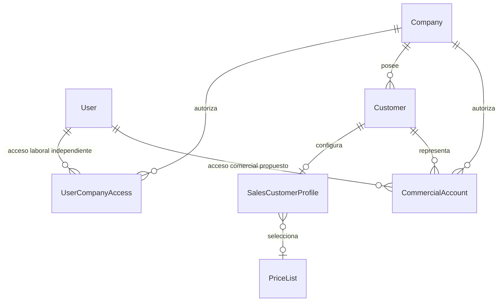

# Cuentas comerciales y solicitudes WhatsApp: auditoría y propuesta

Actualización19/11/2026: el usuario autoriza continuar B4 y confirma contacto verificado para pedidos básicos, aprobación ADMIN solo para mayoristas y registro público deshabilitado mientras no haya proveedor. Se implementó parcialmente el núcleo de cuentas/pruebas de correo, autorización mayorista y recálculo interno; ver [24-avance-b4-d.md](24-avance-b4-d.md). Las propuestas siguientes son antecedentes: registro, sesión comercial, solicitud persistida y WhatsApp siguen pendientes; no se ha activado comercio ni aplicado0010 en la base habitual.

17/11/2026. **Diseño únicamente**: no hay nuevos modelos, migraciones, endpoints de registro, rutas, carrito o envío WhatsApp. Continúa16/18 y `ad_frontend/docs/dashboard-y-registro-clientes.md`. Las propuestas siguientes requieren revisión antes de implementarse.

## Lo que existe realmente

| Fuente | Estado observado | Reutilización / límite |
| --- | --- | --- |
| `users.User` | UUID, email global único, password Django, nombre, teléfono, activo/staff/superusuario | Una identidad por persona; no crear otro sistema de usuarios |
| JWT actual | Login/refresh, selección Company/Store y usuario real | Reutilizar credenciales y motor de tokens; diseñar contexto comercial explícito |
| `/auth/register/` | Requiere autenticación y administración de Company; crea UserCompanyAccess | Es alta laboral administrativa, **no registro público comercial** |
| `partners.Customer` | Cliente canónico, FK Company nullable, documento/nombre/contacto y active | Un mismo usuario puede vincularse a clientes de distintas empresas; no copiar el maestro |
| Unicidad Customer | Company + tipo/número de documento cuando no está vacío | No identifica automáticamente a una persona por correo/teléfono; no fusionar clientes sin documento |
| `SalesCustomerProfile` | OneToOne Customer; lista de precio, condiciones fiscales/pago, notas, active | Reutilizar lista comercial autorizada; no exponer términos, notas o fiscalidad en el perfil público |
| `SalesCustomerContact` | Contacto del cliente: nombre/teléfono/email/cargo | Es un contacto ERP, no demuestra propiedad de una identidad autenticada |
| `UserCompanyAccess`, UserRole, UserStore | Contexto y permisos laborales, revalidados por P0 | No crearlos al registrar un cliente |
| `UserOperationalFlags.see_all_price_lists` | Permiso operativo ERP | No representa aprobación mayorista ni acceso comercial externo |
| PriceList / ProductPrice | Company activa/autorizada, impuesto y moneda | Una lista interna no es pública por existir; B4-B solo usa selección explícita |

No se encontró un vínculo User–Customer, verificación de contacto, aprobación comercial por empresa ni registro de consentimiento en esos modelos. `UserManager.normalize_email` no impone una unicidad completa insensible a mayúsculas; algunos flujos API normalizan más. Auditar posibles variantes existentes antes de proponer una restricción/migración futura.

No reutilizar el alta laboral desde el Website: además de exigir administración, concede membresía laboral. Tampoco reutilizar de forma anónima el selector de clientes de POS, los serializers ERP completos o una búsqueda por documento/correo como comprobación de titularidad. Los validadores de password configurados deben invocarse expresamente en el futuro servicio de registro; `create_user/set_password` por sí solos no ejecutan esa política.

## Vínculo propuesto, sin implementación



Proponer `CommercialAccount` como autorización de un User frente a una Company y su Customer canónico:

- `user`, `company`, `customer`; unicidad inicial `(user, company)`. Varias personas autorizadas pueden representar al mismo Customer empresarial; no asumir OneToOne User–Customer.
- Estado por empresa: `PENDING`, `APPROVED`, `SUSPENDED`, `REVOKED`; actor/fecha y motivo mínimo de aprobación/revocación.
- Contacto verificado mediante una entidad de verificación de identidad reutilizable, con token de un solo uso, hash, expiración y finalidad. Cambiar el contacto invalida su prueba y exige reverificación.
- Company debe ser activa y coincidir con Customer.company. Clientes sin Company o inactivos no se vinculan desde el Website. Es una invariancia de servicio obligatoria y debe conciliarse cómo reforzarla en PostgreSQL al aprobar el esquema: una CheckConstraint no puede comparar dos tablas mediante un join.
- No duplicar la lista de precios en el vínculo si `SalesCustomerProfile.price_list` será su fuente de autoridad. La aprobación del vínculo habilita consultar la lista asignada, siempre activa y de esa empresa. No confundirla con `PriceList.is_default`.
- Si después se requieren varias cuentas comerciales de un usuario en una misma empresa, cambiar esa unicidad mediante decisión explícita y selector de cuenta; no introducir ambigüedad silenciosa ahora.

Una Company en el vínculo es una clave de aislamiento, no una autorización enviada por el navegador. Resolver la Company por el hostname verificado y validar el vínculo vigente desde el servidor en cada operación. Las referencias a cliente, lista y solicitud se filtran por esa Company y el titular.

Flujo de vinculación: usuario solicita acceso en el Website → verifica contacto → se busca únicamente dentro de esa Company un Customer candidato → se solicita revisión si existe un registro empresarial previo → administrador autoriza la relación o crea el Customer canónico mediante servicios existentes. Coincidir con el correo/teléfono/documento de un cliente existente no concede control de su ficha. No sobrescribir sus datos fiscales al editar el perfil de cuenta.

Datos propios editables inicialmente: nombre de contacto y teléfono/correo sujetos a verificación. Dirección y datos fiscales solo cuando el proceso los necesite, con revisión si afectan el maestro ERP. Autenticación/recuperación de cuenta global y autorización comercial por empresa son procesos diferentes.

## Catálogo y precios del cliente

El cliente puede leer productos publicados elegibles del Website. No obtiene el catálogo laboral `/catalog` ni K4–K7 por tener una cuenta comercial.

Propuesta para aprobar: cliente sin autorización mayorista ve la oferta pública disponible; cliente aprobado puede usar la lista de su SalesCustomerProfile validado de la misma Company. Si una lista específica asignada es inválida o carece de precio, devolver null sin fallback silencioso a precios internos. No enviar todos los IDs/listas para que el cliente elija.

La aprobación debe ser revocable por empresa, independiente del contacto verificado. Revocarla invalida el acceso mayorista en la siguiente lectura, incluso con un JWT aún vigente. La caché futura debe separar Company, cuenta, política/lista autorizada y moneda; no basta el dominio o la revisión CMS.

## Autenticación y protección contra abuso

Reutilizar User y el login existente. El nuevo servicio comercial necesitará contexto explícito de cuenta/empresa y validación de finalidad del token, sin que eso sea otro login. Revisar emisión y refresh: hoy el refresh reconstruye claims laborales y no conoce un contexto comercial.

No permitir que un token comercial sea interpretado implícitamente como sesión laboral. Para usuarios mixtos, exigir selección explícita de contexto y permisos independientes. No poner precios, aprobaciones definitivas o PII del cliente en claims duraderos como autoridad.

El futuro registro/recuperación debe responder de forma uniforme ante cuentas existentes, inexistentes o vinculadas a otra empresa; confirmar existencia solo tras autenticación/verificación apropiada. Uniformar mensaje/estado, asincronía y tiempos razonables; una respuesta genérica sin controlar diferencias temporales no resuelve enumeración.

Aplicar límites por IP, dominio, identidad normalizada y destino de contacto, más cuotas globales del proveedor. Tokens con expiración corta y un solo uso, intentos máximos, cooldown y secretos fuera de logs. No implementar envíos SMTP/SMS ficticios como si fuesen verificaciones reales. Cualquier CAPTCHA o proveedor de contacto requiere evaluación y configuración posteriores.

Tests futuros indispensables: registro repetido sin enumeración; contacto cambiado; token reutilizado/expirado; Customer de B desde Website A; mismo User con aprobaciones distintas A/B; revocación con token vigente; acceso por UUID ajeno; roles CMS sin administración comercial; usuario mixto; refresh que conserva la finalidad correcta; privacidad de HTML/RSC/logs.

## Dashboard: recomendación

Conservar `/admin` para el contexto laboral/CMS y preparar **`/cuenta` para clientes** en una entrega futura, reutilizando la apariencia y componentes del contenedor APUDIG Web. No cambiar rutas ahora.

Mantener todo en `/admin` reduciría un punto de entrada, pero su AuthGuard exige Company laboral y mezclaría selección empresarial con autorización comercial. `/cuenta` permite un guard comercial por hostname/vínculo vigente, sin inventar UserCompanyAccess o roles SELLER/CASHIER para clientes. No exige duplicar el sistema de identidad ni reconstruir el dashboard.

La cuenta comercial ofrecería Inicio, Mis datos, Catálogo autorizado, Solicitar acceso mayorista y Mis solicitudes, únicamente cuando sus contratos estén implementados. No mostrar editor Website, catálogo privado, almacenes, proveedores o gestión ERP. La cuenta laboral mantiene el dashboard y permisos actuales. Una persona con ambos accesos selecciona contexto de forma explícita.

## WhatsApp: contrato propuesto, no implementado

Recomendar una solicitud comercial persistida con referencia, separada de SalesQuotation. Esto permite recalcular, deduplicar, auditar y localizar la petición sin convertir una intención en venta. La alternativa de generar solo texto no ofrece trazabilidad ni distingue reintentos; no debe presentarse como pedido recibido.

Ruta futura propuesta: `POST /api/v1/storefront/sites/{hostname}/order-requests/`, con autenticación comercial e `Idempotency-Key`. Body estricto:

```json
{"items":[{"productId":"uuid","unitId":"uuid","quantity":2}],"note":"Consulta de entrega"}
```

No aceptar company_id, customerId, precio, factor, impuestos, stock, descuento ni teléfono de destino del navegador. Cantidades enteras1–999 inicialmente; un máximo acotado de líneas debe acordarse. Propuesta:50 líneas y nota500 caracteres. No implementarlos de forma implícita en B4-B.

El servidor resuelve Website activo/publicado → vínculo comercial vigente → publicaciones actuales → unidades válidas → cantidades → lista autorizada e impuestos → precio/moneda actuales. El ETag de configuración B4-B no demuestra que un precio ERP siga vigente: recalcular y exigir confirmación de un resumen nuevo si cambió desde la lectura del catálogo.

Se identifica al cliente desde la sesión y su vínculo validado; solo se incorporan los datos de contacto necesarios. El destino WhatsApp proviene del contacto de la **revisión CMS publicada**, validado y normalizado, no de ajustes mutables o de un campo enviado por el cliente.

Salida propuesta: `reference`, `status=PREPARED`, `expiresAt`, resumen de líneas/precios/impuestos/total, contacto mínimo, `offerFingerprint` y `whatsappUrl`. El fingerprint corresponde al resumen recalculado; no es una autorización para cambiar valores. Si una línea está retirada, no hay precio autorizado, cambió la unidad o falta WhatsApp publicado, rechazar la preparación con campos accionables; no inventar un total0.

El usuario revisa el resumen y pulsa «Abrir WhatsApp» para decidir enviarlo. El enlace utiliza un destino empresarial fijo y texto codificado; no envía mensajes automáticamente. No registrar `RECEIVED` por abrir el enlace ni por una señal del navegador. Estados propuestos: `PREPARED`, `EXPIRED`, `CANCELLED_BY_CUSTOMER`, `RECEIVED`, `ACCEPTED`, `REJECTED`. Los últimos tres requieren acción verificable del personal o una integración futura aprobada.

Persistir solo lo necesario: referencia no enumerable, Company/Website/CommercialAccount/Customer, líneas y resumen autorizado, moneda, vigencia, estado, actor/fechas y referencia de revisión de contacto publicada. Evitar copiar perfiles completos o datos fiscales innecesarios. Idempotencia ligada a Company y titular; misma clave con body distinto devuelve409. El acceso al historial siempre se filtra por titular/empresa.

No crear ventas, comprobantes, reservas, pagos, movimientos de stock ni SalesQuotation automáticamente. Una conversión ERP posterior requerirá una operación explícita separada, permisos y auditoría.

## Privacidad y retención

Marco peruano a validar con el responsable del tratamiento: Ley29733 y DS016-2024-JUS. El diseño debe limitar datos/finalidades, informar tratamiento y transferencias, recoger consentimiento cuando corresponda y permitir el ejercicio de derechos. El art.31 regula conservación por encargo: no debe interpretarse como un plazo universal para toda cuenta o documento comercial. Fuentes oficiales consultadas el17/11/2026: [Ley y Reglamento, El Peruano](https://diariooficial.elperuano.pe/Normas/obtenerDocumento?idNorma=23) y [norma publicada por ANPD](https://www.gob.pe/institucion/anpd/normas-legales/6554453-n-016-2024-jus).

Propuesta técnica pendiente de aprobación: aviso versionado por empresa, registro mínimo de aceptación/finalidad/fecha, marketing separado de lo necesario para atender la cuenta, datos fiscales opcionales hasta ser necesarios y aviso específico antes de compartir el resumen por WhatsApp. No guardar contraseñas/tokens en claro ni DNI, direcciones o PII en URLs/logs.

Definir una matriz de conservación por finalidad antes del registro: tokens de verificación con TTL y purga; altas no verificadas con caducidad; cuentas revocadas con revisión de supresión/anonimización; solicitudes comerciales y evidencias con plazos aprobados; documentación ERP con su obligación específica. Alinear copias de seguridad, baja del tenant y proveedores. No se fija un plazo legal genérico ni se almacena indefinidamente por defecto.

También deben definirse las responsabilidades de empresa/APUDIG, encargados y proveedores, registro aplicable de bancos de datos, acceso del soporte, transferencias y procedimiento de derechos/incidentes. Estos son pendientes de diseño/operación; este informe no acredita cumplimiento legal ni implementa almacenamiento de datos de clientes.

## Decisiones pendientes para la siguiente entrega

Datos obligatorios de registro; verificación de email/teléfono y proveedor; revisión de Customer existente; aprobadores por empresa; rol de representantes de clientes jurídicos; lista comercial y prioridad; rutas y contexto de sesión; límites/vigencia/idempotencia de solicitudes; retención y aviso de privacidad. Aprobar el contrato de solicitud persistida antes de crear su modelo o endpoint. No iniciar esa implementación con el cierre de B4-B.
